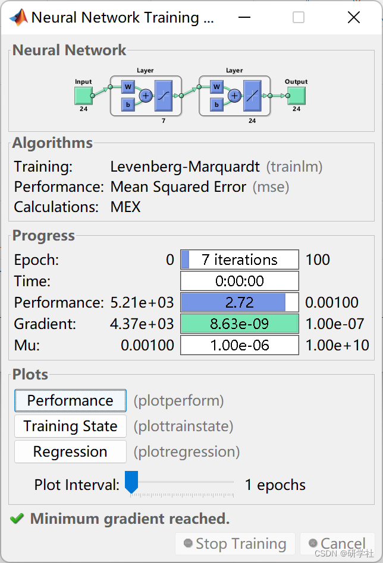
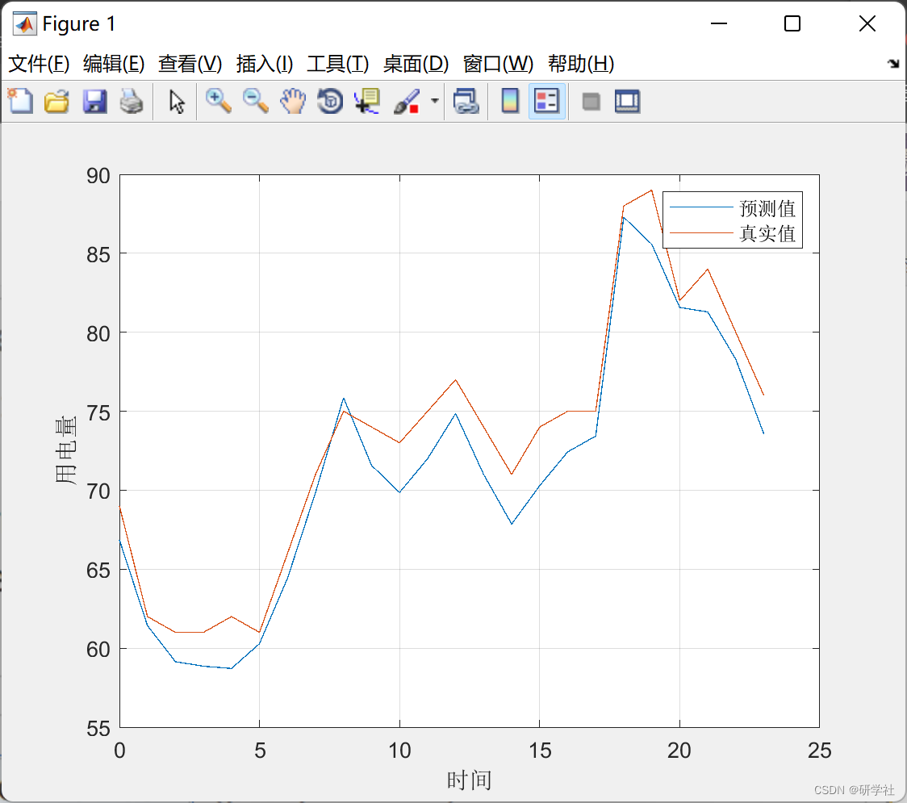

# Power Load Forecast Based on BP Neural Network (Matlab Code Implementation)

💥💥💥💞💞💞 Welcome to this blog❤️❤️❤️ 💥💥💥 🏆 Blog advantages: 🌞🌞🌞 The content of the blog strives for rigorous thinking and clear logic to facilitate readers. ⛳️ Mantra: "Those who travel a hundred miles in a single stretch, are half way through by the ninetieth mile." 1 Overview 2 Run results 3 Complete MATLAB code implementation 4 Data 1 Overview As the power industry gradually enters the market, the short-term power load forecasting in regional distribution networks is becoming increasingly important in the power industry. Precise short-term load forecasting methods are crucial for the safe and stable operation of the power system. Therefore, based on a comprehensive analysis of actual load characteristics and the principles of BP neural networks, this article proposes a BP neural network prediction method.
2 Run results
​ Edit
3 Complete MATLAB code implementation

## Images

<!-- PAYMENT_BLOCK -->

## Get this dataset

- Payment link (Stripe): [Buy now](https://buy.stripe.com/3cs8yP7sY87d0vu9AB)
- Payment QR code: 

<!-- /PAYMENT_BLOCK -->
